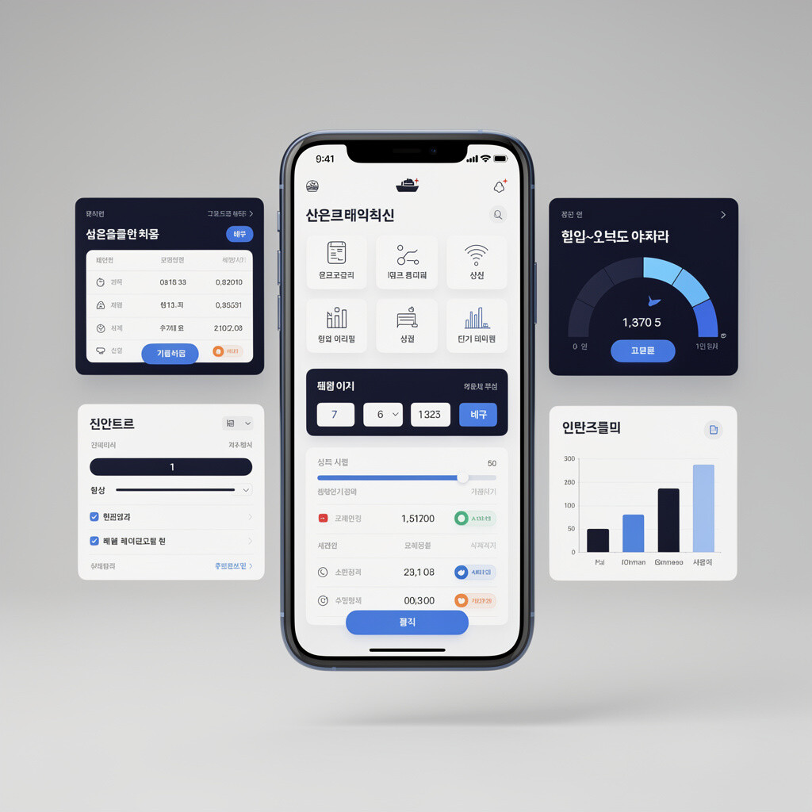

# BUSAN HAK PORT INFO (BUSAN-HAK-PORT-INFO)

부산항 신항·북항 현장 근로자를 위한 스마트 작업 가이드 플랫폼 (v2027 에디션)입니다.

---

## 🔒 저작권 및 이용 조건 (필독)

**이 저장소는 비공개(Private) 저장소이며, 오픈소스가 아닙니다. 라이선스가 부여되지 않았습니다.**

- 저작권자: **이춘학** (문의: `luxrank@gmail.com`) · Copyright (c) 2026
- 저장소 접근은 **명시적으로 초대된 협업자에게만** 허용됩니다. 외부 fork·clone·ZIP 내보내기는 차단되어 있습니다.
- 저작권자의 **사전 서면 동의 없이** 복제·다운로드·배포·공중송신·수정·2차적 저작물 작성·상업적 이용·역분석·디컴파일을 할 수 없습니다.
- 자동화된 수단(크롤러·스크래퍼·AI 학습용 수집기)으로의 수집도 금지됩니다.
- 전체 조건은 [`LICENSE`](LICENSE) 파일에 정리되어 있습니다.
- 이미 배포된 웹사이트의 화면·스크립트도 동일하게 보호됩니다. 배포본은 `npm run build:obfuscate` 로 압축·난독화되며, 모든 산출물 상단에 저작권 배너가 자동 삽입됩니다.

## 📦 배포 파이프라인 (압축·난독화)

| 단계 | 동작 |
| --- | --- |
| 원본 | `public/` — 개발·관리용 원본 소스 (저장소에만 존재, 배포되지 않음) |
| 빌드 | `npm run build:obfuscate` → `build/public/` 생성 (JS·CSS 압축 + 지역 식별자 난독화 + 저작권 배너 삽입) |
| 검증 | 빌드가 끝나면 전역 함수 275개 보존 여부·통합 스크립트 문법을 자동 검사하고, 실패 시 배포를 중단합니다 |
| 서빙 | `server.ts` 가 `build/public/` 을 우선 제공하고, 없으면 `public/` 으로 자동 대체합니다 (빌드 실패에도 화면 유지) |
| 배포 | Vercel: `vercel.json` 이 `outputDirectory: build/public` 지정 (이 설정이 없으면 프리셋 기본값인 원본 `public/` 이 그대로 배포됩니다) + `api/[...path].ts` 서버리스 함수가 `/api/*` 처리 · Firebase Hosting: `firebase.json` 의 `predeploy` 훅이 자동 실행 |

원본 그대로 보고 싶을 때(로컬 개발)는 `npm run dev` 로 `public/` 을 그대로 사용하면 됩니다.

> ✅ **Vercel 은 이제 Node 런타임(서버리스 함수) 구성으로 배포됩니다.**
> `/api/*` 는 `api/[...path].ts`(Vercel Function)가 `server.ts` 의 Express 앱을 그대로 실행해 처리하고,
> 나머지 경로는 `build/public` 정적 산출물을 CDN 이 서빙합니다(과거처럼 index.html 로 폴백되지 않습니다).
> 스케줄 감시·DB 정리·백업 등 주기 작업 트리거와 필요한 환경변수 등록은
> 아래 **"Vercel 배포 구성 (Node 런타임 + 정적 하이브리드)"** 절을 참고하세요.

## 🔐 화면 잠금 비밀번호 (PIN) 관리

근무일지·상세 통계 화면 잠금 비밀번호는 **소스코드에 존재하지 않습니다.**

1. **서버 검증(1순위)**: 브라우저가 `POST /api/screen-unlock` 으로 PIN 을 보내면, 서버가 환경변수 `SCREEN_LOCK_PIN` 과 상수 시간 비교로 검증하고 12시간 유효 토큰을 발급합니다. IP 당 10분에 10회로 시도 횟수가 제한됩니다.
2. **오프라인 대비(2순위)**: 정적 호스팅·서버 장애 시에는 빌드 시 주입된 SHA-256 해시(`window.__SCREEN_LOCK_SHA256__`)와 비교합니다. 평문 PIN 은 번들에 없습니다.

| 환경변수 | 설명 |
| --- | --- |
| `SCREEN_LOCK_PIN` | 화면 잠금 비밀번호. **미설정 시 기존 기본값(`9445`)이 쓰이므로 반드시 변경하세요.** |
| `UNLOCK_TOKEN_SECRET` | 잠금 해제 토큰 서명 키(32자 이상 권장). 미설정 시 `SCREEN_LOCK_PIN` 사용 |
| `EMERGENCY_NOTICE_PIN` | 🚨 긴급 플로팅 공지 작성 비밀번호. **지정하면 그 값만** 인정됩니다(화면 잠금 PIN 과 분리 운영). **미설정 시에는 `SCREEN_LOCK_PIN` 과 기본 관리자 PIN(`9445`)을 함께 인정**합니다 — 근무일지 잠금 비밀번호를 다른 값으로 바꾼 배포에서도 안내된 기본 비밀번호로 열 수 있습니다. 검증 경로는 `POST /api/emergency-unlock`(1순위) → 빌드 주입 해시 `window.__EMERGENCY_PIN_SHA256__` · `window.__SCREEN_LOCK_SHA256__` · `window.__EMERGENCY_DEFAULT_PIN_SHA256__`(2순위)입니다. |

> **Vercel**: Project Settings → Environment Variables 에 등록하세요. 이제 Vercel 에서도 서버
> API(Node 런타임 함수)가 동작하므로 **서버 검증(1순위)이 운영에서 실시간으로 작동**하고,
> 오프라인 대비용 해시도 계속 빌드 시점에 HTML 에 주입됩니다. 등록 후 **Redeploy** 를 한 번 실행해야 반영됩니다.
> **Firebase Hosting** 은 여전히 순수 정적이라 서버 API 가 없습니다 — 해시 폴백(2순위)이
> 사용되므로 동일하게 GitHub Actions 시크릿에 등록하세요. `.env` 는 커밋하지 않습니다.
>
> ※ 이 화면 잠금은 **편의용 UI 게이트**입니다. 실제 데이터 접근 권한은 `firestore.rules` 의 `isAdmin()`(관리자 UID 화이트리스트)이 단독으로 통제합니다.

---

## 프로젝트 개요

이 프로젝트는 항만 근로자들이 실무에서 자주 필요한 정보를 빠르게 확인하고, 정밀한 임금 계산 및 근무일지 정산을 한곳에서 관리할 수 있도록 구성된 스마트 웹 애플리케이션입니다.

### 🚀 v2027 주요 기능 및 오늘 업데이트 내역:
- **🚢 당일 작업 선박 최대 4척(더블·트리플·쿼드오더) 지원**: 임금계산기·근무일지에서 선박을 최대 4척까지 선택하면 선박별 입·출항 시각으로 근무시간이 각각 계산·합산되고, 선박별 임금이 `임금 1~4` 로 자동 분리 입력됩니다. `⏱️ 선박별 자동계산` 블록은 1~4번 4칸 구조이며, 평소에는 1·2번만 보이고 3~4척 선택 시 3·4번이 나타납니다(노출 블록은 항상 균등 크기, 합계 높이는 `⏳ 총 근무시간` 정사각형과 일치). 근무일지의 `임금 3·임금 4` 입력칸도 같은 규칙으로 열리며 총액·월간/연간 통계·CSV·리포트에 모두 반영됩니다.
- **🚨 긴급 플로팅 공지 (관리자 전용)**: 상단 흐르는 문구(티커)와 **별개**로, 관리자가 작성한 긴급 메시지를 모든 접속자 화면 상단에 띄웁니다. 게시 ON/OFF 와 게시 기간(시작·종료)을 지정할 수 있고 기간이 끝나면 자동으로 사라집니다(1분 주기 재평가). 표시 단계(🔴 긴급 / 🟠 주의 / 🔵 안내)를 고를 수 있으며, 접속자는 ✕ 로 접고 오른쪽 아래 🚨 버튼으로 다시 열 수 있습니다. 작성은 서버 환경변수(`EMERGENCY_NOTICE_PIN`)로 검증되는 관리자 비밀번호 인증을 통과해야만 가능하며 **평문 비밀번호는 소스에 없습니다**.
- **⭐ 내 단골 터미널 빠른 실행 바**: 1·2·3항업 9개 터미널 즐겨찾기 고정 및 스케줄·차트·현황·베이플랜·셔틀·식단 1초 실행
- **🧮 정밀 임금 계산기 & 근무일지 원클릭 전송**: 주·야간 자동 분리, 2026~2027년 공휴일 반영, `[📐 입력창 넓게 보기]` 전환 및 계산 결과 근무일지 자동 입력
- **🎯 근무일지 목표 수입 달성률 게이지 바 & 동료 자동완성 칩**: 월 목표 금액 설정, 실시간 달성률(%) 게이지, 자주 쓰는 동료 이름 원클릭 입력 칩 (선박명은 터미널별 입항·접안 선박 칩으로 입력)
- **🔄 근무일지 입력 폼 초기화 버튼**: 임금계산기와 같은 초기화 버튼을 근무일지에도 제공 — 배 이름·임금 1·2·근무자·작업 내용·현장 사진 입력을 한 번에 비우고, 내용이 있을 때는 확인창으로 실수 방지 (저장된 기록은 안전하게 유지)
- **📊 D3.js 월별 수입·근로일수 그래프 & 연간 종합 정산 보고서**: 기간·키워드 검색, 분기별 실적, 주요 선박·동료 TOP 3, 보고서 복사 및 명세서 이미지(PNG) 저장·카톡 공유 (`9445` 보안 잠금)
- **🚢 선박 도감 난이도 별점(★1~5) & 장비 태그 필터 + 전체 선박 목록 뷰**: `#오토콘`, `#수동콘`, `#브릿지주의` 등 장비 태그와 `#찬구콘♡`, `#수열콘♡`, `#브라보콘`, `#월드콘`, `#닭다리콘`, `#개콘`, `#영구콘♡`, `#광명콘♡` 등 게시글 태그 필터링 및 상단 고정 헤더·줄무늬 컴팩트 전체 목록 테이블 (`#vessel-result-container`, `9445` 보안 잠금), 신규 선박 등록 시 날짜·터미널별 입항 선박 원클릭 자동입력 탑재
- **⚓ 9개 터미널 선석배정 스케줄 연동**: 근무일지 및 선박정보 신규등록 시 날짜·터미널(한진 HJNC, 동원 DGT, 고려 BNCT, BCT, PNC, HPNT, PNIT, BPTC, HBCT)별 실시간 입항·접안 선박 칩 조회 및 원클릭 자동입력
- **🎲 스트레스 해소(왁자지껄) 항만용어 닉네임 자동 기입**: 글쓰기 폼을 열면 도선사·검수원·라싱 반장 등 항만 현장 직군 닉네임이 자동 입력되고, `🎲 새 닉네임` 버튼으로 다시 뽑기 가능. 기존처럼 직접 수정·입력도 그대로 지원 (댓글 닉네임 칸도 동일하게 자동 기입, 브라우저에 마지막 닉네임 저장)
- **💬 꿍꿍따 끝말잇기 "댓글 릴레이" (현장가이드 탭)**: AI·2인 **대전(승부) 방식이 아니라**, 동료들이 **시간 날 때마다 댓글 한 줄(세 글자 단어)** 을 남기며 끝말을 이어 쓰는 릴레이입니다. 턴 제한 시간·점수판·승패 화면이 없어 언제 참여하고 언제 나가도 되며, Firestore `kkung_chain/active`(현재 릴레이 상태) + `kkung_chain/active/comments`(단어 댓글) 에 저장되어 **모든 사용자에게 실시간 공유**됩니다. 카드를 펼쳐 볼 때만 구독(접으면 해제)해 읽기 비용을 아끼고, 릴레이가 막히거나 30개를 채우면 누구나 `🔁 새 출발` 로 다음 릴레이를 열 수 있습니다(연속 갈아엎기 방지를 위해 60초 간격 제한). 막힐 때는 내장 사전 507개 단어 기준 `💡 이어갈 단어 추천` 을 칩으로 보여주며, 사전에 없는 실제 단어도 세 글자 한글이면 댓글로 남길 수 있습니다(게시판과 동일한 금칙어·도배 필터 적용, 이어 쓴 단어는 작성자도 수정·삭제 불가 — 관리자만 정리).
- **🛡️ 보안 강화 & 정밀 방문자 통계**: Firebase 익명 인증 자동 연결, 관리자 UID·이메일 화이트리스트 + SHA-256 단방향 해시 검증, 전 컬렉션 비밀번호 SHA-256 해시 암호화, 자정 경계(`dateKey`) 분리 및 `localStorage` 기반 일일 순 방문자(Unique)·재방문율 KPI 통계
- **📅 누적 근무일지 통합 상세보기 모달**: 근무일지 상단 배너 및 운영 통계 대시보드(`📅 누적 근무일지 기록`)에서 진입하여 전체 근로자·기간·선박·동료·메모 다중 필터 검색, 근로자·선박 TOP 5 요약, CSV(엑셀) 저장 및 분석 리포트 원클릭 복사 지원
- **📊 화면 좌측 상단 '오늘 방문자' 실시간 배지**: 상단 헤더 왼쪽에 오늘 일일 방문자(세션 기준) 수치를 `visitor_stats/daily-{dateKey}` 실시간 리스너로 즉시 표시합니다. 자정 경계 자동 전환(날짜가 바뀌면 새 날짜로 재구독) 및 탭 복귀·절전 해제 시 자동 복구를 지원하며, 배지를 터치하면 현재 집계 수치를 안내하고 관리자 인증 세션에서는 상세 통계 모달이 바로 열립니다.
- **🌬️ 부산항 실시간 기상 · 작업 안전 전광판**: 부산 신항·북항 실시간 기온·체감온도·풍속(m/s)·강수량 및 강풍 작업 통제 안내
- **🎨 전체 화면 디자인 대개편 & 야간(다크) 모드**: 항업별 맞춤 그라데이션 배너, 카드별 실시간 데이터 건수 요약, 달력 '오늘' 배지 및 만 원 단위 수입 요약 칩
- **운영관리자**: 이춘학 (문의: `luxrank@gmail.com` / `010-2846-8906`)

## 배포 상태

공개 URL:

| 구분 | URL | 배포 방식 | 상태 (2026-10-06 기준) |
| --- | --- | --- | --- |
| **운영 (1차)** | https://busan-hak-port-info.vercel.app | Vercel — GitHub `main` 브랜치 머지 시 **자동 프로덕션 배포** (정적 `build/public` + Node 런타임 함수 `/api/*`) | ✅ 최신(v2027) 서비스 중. 현장 사용자 기준 운영 주소 |
| 레거시 (보조) | https://busan-hak-port.web.app | Firebase Hosting — 승인형 GitHub Actions 워크플로 | ⚠️ v2026 구버전 게시 중. 원본 프로젝트 배포 키 미등록으로 갱신 중단 (아래 "승인형 Firebase 배포" 참고) |

> ⚠️ **데이터 저장소 유의**: 호스팅 위치와 무관하게 앱의 모든 Firestore·Storage 데이터(공지사항·공지 이미지, 근무일지, 게시판, 선박정보, 방문 통계)는 Firebase 프로젝트 **`busan-hak-port`**(프로젝트 번호 `616469111502`)에 저장됩니다. 이 프로젝트는 운영 데이터의 심장이므로 **삭제·보관 정지하면 안 됩니다.** 프로젝트 접근이 안 되는 계정(luxrank75@gmail.com 등)에서는 보이지 않을 수 있으며, 원본 소유 Google 계정에서의 접근 복구가 선행되어야 합니다.

## ☁️ Vercel 배포 구성 (Node 런타임 + 정적 하이브리드)

운영 사이트는 **정적 자산 + 서버리스 Node 함수** 조합으로 배포됩니다.

| 경로 | 처리 주체 |
| --- | --- |
| `/api/*` (단일 세그먼트) | `api/[...path].ts` (Vercel Function · Node 런타임) → `server.ts` 의 Express 앱에 위임. 인천 리전(`icn1`)에서 실행되어 국내 터미널 사이트 수집 지연이 짧습니다 |
| `/api/cron/*` (2세그먼트) | `api/cron/{schedule-watch,daily-cleanup,weekly-backup}.ts` **개별 함수 파일** (아래 "Vercel 라우팅 제약" 참고) |
| 그 외 모든 경로 | Vercel CDN 이 `build/public`(압축·난독화 산출물)을 정적 서빙. 파일이 없는 경로는 `index.html` 로 폴백(SPA rewrite). 캐시·보안 헤더는 `vercel.json` `headers` 가 `firebase.json` 과 동일 정책으로 적용 |

Vercel 에서 동작하는 서버 API(로컬 `npm run dev` 와 동일한 코드입니다):

- `GET /api/health` — 서버·터미널 헬스체크. `platform: "vercel-serverless"` 이면 Vercel 함수가 살아 있다는 뜻입니다
- `GET /api/config` — Web Push VAPID 키 등 공개 설정
- `POST /api/screen-unlock` — 화면 잠금 PIN 서버 검증(1순위). `trust proxy` 설정으로 **실제 클라이언트 IP 기준** 속도 제한(IP당 10분 10회)이 동작합니다
- `POST /api/emergency-unlock` — 🚨 긴급 플로팅 공지 작성 PIN 서버 검증(1순위). 화면 잠금과 **별도 시도 횟수 버킷**을 사용해, 근무일지 잠금 실패가 긴급 공지 인증을 막지 않습니다
- `GET /api/hjnc-schedule` · `GET /api/terminal-schedule` — 8개 터미널(`HJNC`·`BNCT`·`DGT`·`PNC`·`HPNT`·`PNIT`·`BPTC`·`HBCT`) 실시간 선석 스케줄(메모리 캐시 → Firestore 캐시 stale-while-revalidate 폴백)
- `GET /api/cron/*` — 주기 작업 트리거(아래 참고, `CRON_SECRET` 인증 필수)

### ⚠️ Vercel 라우팅 제약 — 2세그먼트 경로는 개별 함수 파일이 필요합니다

`api/[...path].ts` catch-all 은 **단일 세그먼트** 경로(`/api/health`, `/api/config`, …)에만 매칭됩니다.
2세그먼트 이상 경로(`/api/cron/schedule-watch` 등)는 함수에 도달하지 못하고 **Vercel 플랫폼 라우터가
404(NOT_FOUND)** 를 반환합니다. 즉 `api/` 디렉터리에 파일이 있어도 매칭되지 않는 경로가 생깁니다.

| 증상 | 의미 | 조치 |
| --- | --- | --- |
| **404 + Vercel `NOT_FOUND` HTML 페이지** | 함수가 호출되지 않음(라우팅 실패). 비밀번호 문제 아님 | 경로를 개별 함수 파일로 노출 |
| **401 + `{"ok":false,"error":"unauthorized"}`** | 함수 정상 호출, `CRON_SECRET` 값 불일치 | Vercel·GitHub 양쪽 시크릿 값 일치 |
| **503 + `{"ok":false,"error":"cron_secret_not_configured"}`** | Vercel 에 `CRON_SECRET` 미등록 | 환경변수 등록 후 Redeploy |

따라서 주기 작업 경로는 `api/cron/<task>.ts` **개별 함수 파일**로 노출하고(`server.ts` 의 Express 앱을 그대로
위임), 단일 세그먼트 별칭 경로(`/api/cron-schedule-watch` 등)도 함께 등록해 어느 한쪽 라우팅에도 의존하지
않도록 했습니다. 두 경로 모두 동일한 핸들러·인증(`CRON_SECRET`)을 사용합니다.

같은 이유로 **잠금 해제 경로도 개별 함수 파일**로 노출합니다.

- `api/screen-unlock.ts` → `POST /api/screen-unlock`
- `api/emergency-unlock.ts` → `POST /api/emergency-unlock`

이 파일이 없으면 Vercel 이 404(`NOT_FOUND`)를 반환해, 화면에서 올바른 비밀번호를 입력해도
서버 검증이 실행되지 않습니다(증상: "긴급 공지 비밀번호 인증이 안 됨"). 브라우저는 이때
빌드 주입 해시(2순위)로 자동 대체 검증합니다.

### 주기 작업 (스케줄 감시 · DB 정리 · 백업)

서버리스는 응답 후 프로세스가 동결되어 `node-cron` 타이머가 발화하지 않습니다. 상시 프로세스 서버(로컬·셀프호스팅)에서는 기존처럼 `node-cron` 이 돌고, **Vercel 에서는 외부 스케줄러가 `/api/cron/*` 엔드포인트를 호출**해 동일한 작업을 실행합니다. 모든 크론 엔드포인트는 `Authorization: Bearer <CRON_SECRET>` 헤더를 요구합니다(시크릿 미등록 503, 불일치 401 — 익명 트리거 불가).

| 작업 | 엔드포인트 | 트리거 | 주기 |
| --- | --- | --- | --- |
| 선박 스케줄 변경 감지 + FCM 푸시 | `/api/cron/schedule-watch` | GitHub Actions `cron-schedule-watch.yml` | 매시간 5분 (UTC) |
| DB 자가 정리(30일 캐시·14일 읽은 알림 TTL) | `/api/cron/daily-cleanup` | Vercel Cron (`vercel.json` crons) | 매일 03:00 (UTC) |
| 주간 Firestore 백업 | `/api/cron/weekly-backup` | Vercel Cron (`vercel.json` crons) | 매주 일요일 00:00 (UTC) |

> **왜 스케줄 감시만 GitHub Actions 인가** — 운영 Vercel 프로젝트는 **Hobby(무료) 플랜**이라
> `vercel.json` crons 에 1일 1회 초과 빈도(`0 * * * *` 등)를 등록하면 **배포가 실패**합니다
> ("Hobby accounts are limited to daily cron jobs"). Pro 플랜으로 이전한다면
> `vercel.json` crons 에 `{ "path": "/api/cron/schedule-watch", "schedule": "0 * * * *" }` 를
> 추가하고 이 워크플로를 삭제하면 됩니다.

**환경변수 등록 (1회 필요)**

1. **Vercel** Project Settings → Environment Variables: `SCREEN_LOCK_PIN`, `UNLOCK_TOKEN_SECRET`, `FIREBASE_SERVICE_ACCOUNT_KEY`(Base64), `VAPID_KEY`, `CRON_SECRET`(권장: `openssl rand -hex 32`) — 등록 후 **Redeploy**
2. **GitHub** Settings → Secrets and variables → Actions: `CRON_SECRET` — Vercel 과 **동일한 값** (매시간 트리거 인증용). 미등록 시 매시간 워크플로가 실패 알림을 띄웁니다

`CRON_SECRET`·`FIREBASE_SERVICE_ACCOUNT_KEY` 가 없어도 사이트와 화면 잠금(빌드 해시 폴백)은 동작하지만, 스케줄 API 의 Firestore 폴백·FCM 알림·주기 작업은 동작하지 않습니다.

### 서버리스 특성·한계

- 메모리 캐시(스케줄 stale 캐시)와 PIN 속도 제한 상태는 **함수 인스턴스 단위 best-effort** 입니다(인스턴스가 여러 개이거나 재활용되면 초기화됨). Firestore `vessel_schedules_cache` 폴백 체인은 기존과 동일하게 동작합니다.
- 주간 백업은 Vercel 에서 `/tmp` 에만 쓸 수 있어 **파일이 영구 보존되지 않습니다**(응답에 `note` 필드로 표시). 영구 백업은 상시 프로세스 서버 배포(로컬 `backups/`)에서만 유효합니다.
- 함수 실행 시간은 Vercel 기본값(Fluid compute, 전 플랜 300초)을 사용합니다 — 별도 `maxDuration` 설정 없음.
- **Firebase Hosting(busan-hak-port.web.app)은 변경 없이 순수 정적**입니다 — 서버 API 가 없으므로 화면 잠금은 빌드 시 주입된 해시 폴백(2순위)으로 동작합니다.

## 🎨 디자인 시스템 (v2027.4)

색·간격·타이포·형태·모션을 **토큰 단일 소스**로 관리합니다. 화면 코드는 `var(--토큰)` 만 참조하고, 원시값은 오직 `scripts/design-tokens.mjs` 에만 존재합니다.



| 항목 | 내용 |
| --- | --- |
| 토큰 정본 | `scripts/design-tokens.mjs` — 188개 토큰(뉴트럴 램프 · 팔레트 · 시맨틱 · 간격 · 타이포 · 라운드 · 고도 · 모션 · Z축) |
| 기준서 | [`docs/디자인_시스템_가이드.md`](docs/디자인_시스템_가이드.md) — 원칙, 스케일 표, 컴포넌트 규칙, 접근성 체크리스트 |
| 쇼케이스 | [`docs/images/`](docs/images) — 라이트 / 다크 / 데스크톱 UI/UX 목업 |
| 적용 | `npm run tokens:apply` (멱등 · 재실행 안전) |
| 검증 | `npm run tokens:check` · 테스트 12종 (CI `npm run check` 에 포함) |
| 문서 동기화 | `npm run tokens:docs` (가이드 부록 표 자동 재생성) |

**마이그레이션 성과(2026-10-16)** — 하드코딩 값 **1,210건**을 토큰으로 치환했고, CSS 선언 구조 변화는 **0건**(선언 3,210개·선택자·순서 완전 동일)입니다. 값 변경은 타이포 스케일 정렬 67건(≤0.02rem)·라운드 정렬 14건(≤1px)·표기 정규화 16건(`#fff`=`#ffffff`, `bold`=`700`, `12px 12px`=`12px`)뿐으로, 화면 렌더링 결과는 동일합니다.

**운영 규칙**

1. 새 색·크기·간격이 필요하면 화면 코드가 아니라 `scripts/design-tokens.mjs` 에 토큰을 추가한 뒤 `npm run tokens:apply` 를 실행합니다.
2. 같은 값을 2회 이상 하드코딩하면 CI가 차단합니다(팔레트 등록 또는 기존 토큰 재사용 필요).
3. 다크 모드는 시맨틱 토큰(`--primary`, `--bg-color` 등)만 재정의하고, 팔레트 값은 변경하지 않습니다.
4. 인라인 스타일 내 하드코딩 색상은 baseline(459건)을 넘길 수 없습니다 — 감소만 허용.

## 기술 스택

- Frontend: HTML5, CSS3, Vanilla JavaScript (ES2022+), D3.js v7
- Backend Proxy: Node.js, Express (`server.ts` — 터미널 실시간 선석배정 수집 및 인메모리 캐싱). 로컬에서는 상시 프로세스로, Vercel 에서는 `api/[...path].ts` 를 통한 서버리스 Node 런타임 함수로 동일한 앱이 동작합니다
- Cloud & BaaS: Vercel (정적 + Functions + Cron), Firebase Hosting, Firebase Authentication (Anonymous & Admin Auth), Cloud Firestore (`firestore.rules`), Firebase Storage, Firebase Cloud Messaging (FCM)

## 프로젝트 구조

```text
BUSAN-HAK-PORT-INFO/
├── public/
│   ├── index.html            ← 화면 마크업(인라인 스타일·스크립트 분리됨 — A-1)
│   ├── admin.html            ← 정적 안내 페이지(토큰 부분 집합 사용)
│   ├── css/app.css           ← 디자인 토큰 정본(:root) + 전체 스타일(런타임 정본, ?v= 캐시)
│   ├── js/                   ← 전역 스크립트(app.js 정본, notifications.js, …)
│   ├── manifest.json
│   ├── service-worker.js
│   ├── favicon.ico
│   ├── icon-192.png
│   ├── icon-512.png
│   ├── robots.txt
│   ├── sitemap.xml
│   └── ads.txt
├── docs/
│   ├── 디자인_시스템_가이드.md   ← 색·간격·타이포·형태·모션 기준서(토큰 표 자동 생성)
│   ├── 앱_개선_전략_제안서.md    ← 디자인 변경 없이 진행하는 개선 방향·개선안·로드맵(2026-10-16)
│   └── images/                  ← UI/UX 쇼케이스 이미지
├── api/
│   ├── [...path].ts           ← Vercel 서버리스 함수 진입점 (단일 세그먼트 /api/* 를 server.ts Express 앱에 위임)
│   └── cron/                  ← 2세그먼트 주기 작업 경로용 개별 함수 (catch-all 은 2세그먼트 미매칭 → 플랫폼 404)
│       ├── schedule-watch.ts  ← 매시간 FCM 스케줄 변경 감지 트리거
│       ├── daily-cleanup.ts   ← 매일 DB 자가 정리 트리거 (Vercel Cron)
│       └── weekly-backup.ts   ← 매주 Firestore 백업 트리거 (Vercel Cron)
├── .github/
│   └── workflows/             ← CI · 승인형 Firebase 배포 · 매시간 스케줄 감시(cron-schedule-watch.yml)
├── scripts/
│   ├── design-tokens.mjs        ← 🎨 디자인 토큰 정본(단일 소스)
│   ├── apply-design-tokens.mjs  ← 토큰 적용·검증·문서 생성기
│   └── design-tokens.test.mjs   ← 디자인 시스템 회귀 방지 테스트
├── server.ts
├── vercel.json                 ← Vercel 배포 설정(정적 build/public + crons + 헤더 + icn1 리전)
├── firestore.rules
├── firebase-blueprint.json
├── firebase.json
├── package.json
└── README.md
```

## 로컬 실행

Node.js Express 서버(`server.ts`)를 통해 정적 파일 서빙과 실시간 터미널 선석 스케줄 API(`/api/terminal-schedule`, `/api/hjnc-schedule`)를 함께 실행할 수 있습니다.

```bash
npm install
npm run dev
```

그다음 브라우저에서 아래 주소로 접속합니다.

```text
http://localhost:3000
```

## 검사 및 빌드

```bash
npm ci
npm run check
```

`npm run check`는 TypeScript 타입, 필수 배포 파일, JSON 형식, HTML 문서 및 인라인 JavaScript 문법을 검사합니다. 여기에 더해 **디자인 토큰 검증**(`npm run tokens:check`)이 포함되어, 하드코딩된 색·간격·타이포 값이 다시 늘어나거나 토큰 정의와 화면 코드가 어긋나면 CI가 실패합니다. 추가로 `.github/workflows/*.yml`의 YAML 문법과, Firebase 배포 시크릿을 참조하는 작업들의 `environment` 범위 일치 여부를 검사합니다. Pull Request와 `main`/`arena/**` 브랜치 푸시에서도 동일한 검사가 자동 실행됩니다.

## 승인형 Firebase 배포

> **2026-10-06 상태 안내**: 현재 등록된 서비스 계정 키가 **다른 프로젝트(`busan-hak-port-paid-2026`) 소속**이라 실제 배포 대상인 `busan-hak-port` 프로젝트를 배포할 권한이 없어, 최근 실행들이 "Failed to get Firebase project" 오류로 실패했습니다. 워크플로우를 개선하여, 이제는 배포용 시크릿이 없거나 **다른 프로젝트의 키인 경우에도** 실패(빨간 X) 대신 안내와 함께 실행을 건너뜁니다. 원본 프로젝트 소속 서비스 계정 키를 아래 방법으로 등록하면 다시 배포됩니다.
>
> ⚠️ 키 발급 시 프로젝트를 반드시 **`busan-hak-port`** 로 선택하세요. 이름이 비슷한 `busan-hak-port-paid-2026` 프로젝트의 키(`firebase-adminsdk-fbsvc@busan-hak-port-paid-2026.iam.gserviceaccount.com`)로는 배포할 수 없습니다.

운영 배포는 GitHub에 코드를 푸시하는 것만으로는 실행되지 않습니다. GitHub Actions의 **Firebase 운영 배포** 워크플로를 수동 실행하고, 질문 **“배포하시겠습니까?”**에 **“예”**를 선택한 경우에만 다음 순서로 배포됩니다.

1. 배포용 서비스 계정 시크릿 존재·`project_id` 확인 (없거나 다른 프로젝트 키면 배포 대신 안내 후 건너뜀)
2. `main` 브랜치인지 확인
3. 의존성 설치
4. 타입 및 정적 파일 최종 검사
5. Google Cloud 서비스 계정 인증
6. Firebase Hosting 운영 배포

“아니요”를 선택하면 배포 명령은 실행되지 않습니다. 동시에 두 운영 배포가 실행되지 않도록 동시 실행도 제한합니다.

### 최초 1회 필요한 GitHub Secret

다음 이름으로 Firebase 배포용 서비스 계정 JSON을 등록해야 합니다.

```text
FIREBASE_SERVICE_ACCOUNT_BUSAN_HAK_PORT
```

**저장소 시크릿 한 곳에만 등록하는 것을 권장합니다** (Settings → Secrets and variables → Actions → *Repository secrets*).

`Production` 환경 시크릿으로도 동작합니다. 자격 확인 작업과 배포 작업이 모두 `Production` 환경을 지정해 **동일한 범위**를 읽기 때문입니다. 다만 두 곳에 서로 다른 값을 등록하면 `Production` 환경 값이 우선 적용되어 저장소에 넣은 값은 무시되므로, 혼선을 막으려면 한 곳에만 두세요.

> 자격 확인 작업에 `environment: Production`이 없던 시절에는 저장소 시크릿만 읽혔습니다. 그 상태에서 시크릿을 `Production` 환경에만 등록하면 자격 확인은 "없음"으로 판정되어 **배포가 아무 안내 없이 건너뛰어집니다.** `npm run check`가 이 범위 불일치를 검사하므로 재발을 막습니다.

등록 후 워크플로를 다시 실행하면 자격 확인 단계가 키의 `project_id`가 `busan-hak-port`인지 확인합니다. 다른 프로젝트 키(예: `busan-hak-port-paid-2026`)이면 `"Failed to get Firebase project"` 오류로 실패하기 전에 안내와 함께 건너뜁니다.

서비스 계정 키는 저장소 파일이나 채팅에 올리지 말고 GitHub의 암호화된 Secret에만 저장합니다. 운영 URL은 `https://busan-hak-port.web.app`입니다.

> `server.ts`의 터미널 일정 API는 로컬 Express 실행용입니다. 현재 Firebase Hosting 워크플로는 `public/` 정적 파일만 배포하며 서버 프로세스는 배포하지 않습니다. 운영 화면은 API 응답이 JSON일 때만 해당 응답을 사용하고, 그 외에는 Firestore 캐시를 사용합니다.

## 참고

- 본 사이트는 항만 현장 근로자용 업무 보조 도구를 목적으로 구성되었습니다.
- 일부 기능은 Firebase Firestore 및 Storage를 사용하므로 실제 동작을 위해 Firebase 프로젝트 설정이 필요합니다.
- 관리자 기능, 게시글, 근무일지, 자료실 업로드는 Firestore 기반으로 동작합니다.

## 연락처
- 이름 : 이춘학
- 이메일: luxrank@gmail.com
- 문자: 010-2846-8906

## 라이선스

해당 프로젝트는 개인 운영 목적의 포트폴리오 및 현장 업무 보조 서비스를 위해 제작되었습니다.
